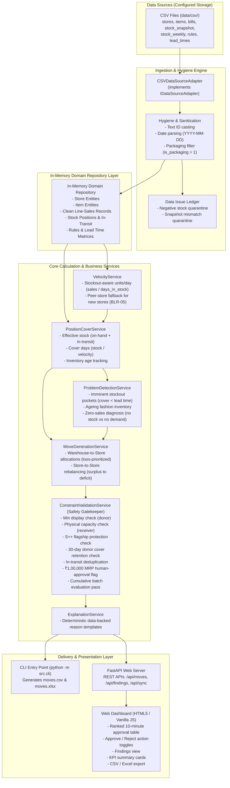
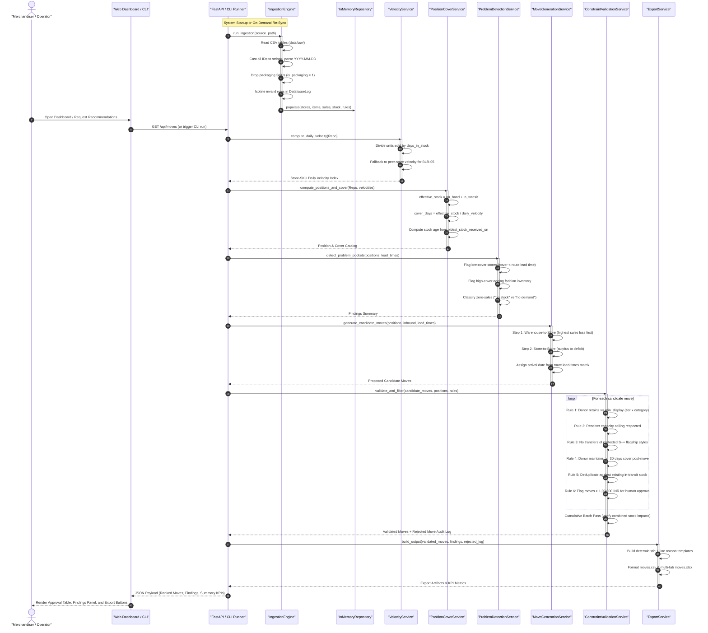

# Daily Stock Move Recommender & Dashboard: System Architecture

## 1. System Overview

The Daily Stock Move Recommender is an enterprise decision-support platform designed for Vedant Fashions (Manyavar). The system automates daily inventory rebalancing across 20 retail stores and 1 central warehouse (`WH-KOL`).

Its primary objective is to evaluate daily sales velocity and current inventory positions, isolate stockout risks and surplus ageing pockets, generate legally valid stock transfers (Warehouse $\to$ Store and Store $\to$ Store), and present an auditable, ranked proposal list to a merchandiser for review within a 10-minute approval window.

---

## 2. Architectural Design Principles

The architecture strictly adheres to three structural paradigms:

1. **Repository Pattern**:
   - High-level business engines (Velocity, Cover, Move Generation, Rule Validation) depend solely on domain abstractions (`IStoreRepository`, `IStockRepository`, `ISalesRepository`, `IRulesRepository`).
   - Data access is isolated behind concrete adapters (`CSVDataSourceAdapter`), allowing underlying data sources to be swapped (e.g. from CSVs to SQL or S3) without modifying domain calculations.
2. **SOLID Principles**:
   - **Single Responsibility (SRP)**: Ingestion, velocity estimation, constraint checking, and presentation are completely decoupled into distinct modules.
   - **Open/Closed (OCP)**: New validation rules or move strategies can be added by implementing standard interfaces without altering the orchestrator.
   - **Liskov Substitution (LSP)**: Repositories and adapters adhere to strict contracts ensuring interchangeability.
   - **Interface Segregation (ISP)**: Clients consume targeted interfaces rather than monolithic data objects.
   - **Dependency Inversion (DIP)**: Core calculation services depend on abstract repository interfaces, not concrete CSV reading operations.
3. **DRY (Don't Repeat Yourself)**:
   - Centralized rule definitions, category mappings (e.g. mapping Safa, Mala, and Stole to Accessories), and lead-time transit matrices ensure zero duplication of domain business logic.

---

## 3. High-Level Architecture Diagram

---

## 4. End-to-End System Sequence Diagram

---

## 5. Detailed Component Specifications

### 5.1 Ingestion & Hygiene Engine
- **Decoupled Source**: Reads strictly from `data/csv/` using standard path configurations. No client-side upload is permitted in the UI, guaranteeing clean data isolation and reproducible pipeline execution.
- **Type Enforcement**: All entity identifiers (`store_id`, `sku_id`, `bill_id`, `salesperson_id`) are parsed as strings to prevent loss of leading zeros or corruption of alphanumeric keys.
- **Packaging Elimination**: Items with `is_packaging = 1` (`PKG-BAG`, `PKG-COVER`, `PKG-BOX`) are stripped from sales velocity, basket metrics, and inventory positions.
- **Quarantine Ledger**: Untrusted records (e.g. `KUR-02-M` at `MYS-02` with on-hand `-4`, `SHW-02-L` at `KNP-03` with 300 units vs 250 store capacity) are logged into a structured `DataIssueLog` and quarantined from move proposals.

### 5.2 Stockout-Aware Velocity Engine
- **Standard Velocity Pitfall**: Traditional velocity divides sales by calendar days ($\frac{\text{units}}{90}$), artificially depressing velocity for items that were out of stock for weeks.
- **Stockout-Aware Formula**:
  $$\text{Daily Velocity} = \frac{\sum \text{quantity sold}}{\sum \text{days in stock}}$$
  Using `stock_weekly.days_in_stock` (range 0 to 7 per week) correctly reflects true customer run-rate.
- **Cold-Start Handling**: Stores with $< 28\text{ days}$ of history (`BLR-05`) have insufficient data; their velocity is borrowed from peer stores of identical tier and city.

### 5.3 Move Generation & Hard Constraints Engine
- **Hierarchy of Replenishment**:
  1. *Warehouse to Store*: Draws from available `WH-KOL` on-hand stock and allocates to stores facing imminent stockouts ($\text{cover} < \text{route lead time}$). Prioritizes stores with the highest expected revenue loss ($\text{velocity} \times \text{MRP}$).
  2. *Store to Store*: Transfers excess inventory from donor stores with surplus cover ($> 45\text{ days}$) to needy stores ($< \text{lead time}$).
- **The 6 Non-Negotiable Hard Rules**:
  1. *Minimum Display*: Donor store must remain $\ge \text{min\_display}$ for its tier and category (with Safa, Mala, and Stole combined under Accessories).
  2. *Physical Capacity*: Total on-hand $+$ in-transit $+$ all newly proposed inbound moves must not exceed `stock_capacity_units` at the receiver.
  3. *Flagship Protection*: No style listed in `flagship_protected.csv` for an S++ store may ever be transferred out of that store in any size.
  4. *In-Transit Deduplication*: Existing in-transit stock counts as arriving inventory; duplicate replenishment is blocked.
  5. *Donor Safety*: A store-to-store move must never leave the donor store with $< 30\text{ days}$ of cover for that style.
  6. *Human Approval Gate*: Any single move valued $> ₹1,00,000\text{ MRP}$ ($\text{quantity} \times \text{MRP}$) is flagged with `requires_human_approval = True`.
- **Cumulative Batch Pass**: Evaluates the entire proposed move list together before finalizing to guarantee that multiple simultaneous moves do not breach capacity or minimum display thresholds cumulatively.

### 5.4 Explainability Engine
- Every approved move contains a deterministic, template-based one-line explanation string constructed from calculated attributes.
- Example: `"Send 12: KUR-05-L has 3 days cover at LKO-02, sells 4/day; donor LKO-01 retains 42 days cover"`.
- Template values are directly bound to underlying row calculations to ensure 100% spot-check auditability.

### 5.5 Presentation Layer (Web Dashboard & CLI)
- **CLI Runner**: `python -m src.cli` executes the entire pipeline headless and outputs `moves.csv` and `moves.xlsx`.
- **FastAPI Backend**: Provides lightweight REST endpoints:
  - `GET /api/moves`: Returns ranked moves with filter parameters (type, store, category, approval flag).
  - `POST /api/moves/{move_id}/decision`: Updates approval status (`Approved` or `Rejected`).
  - `GET /api/findings`: Returns hidden problem clusters (stockouts, ageing, store imbalances).
  - `GET /api/summary`: Returns operational KPIs (total units, moves count, ageing value, stockout count).
  - `GET /api/export`: Downloads the current move list in CSV or Excel format.
  - `POST /api/sync`: Re-executes the ingestion and calculation pipeline from `data/csv/`.
- **Dashboard UI**: Single-page vanilla HTML5, CSS3, and JavaScript interface served directly by FastAPI. Zero build steps, instant load times, and responsive across desktop resolutions.
